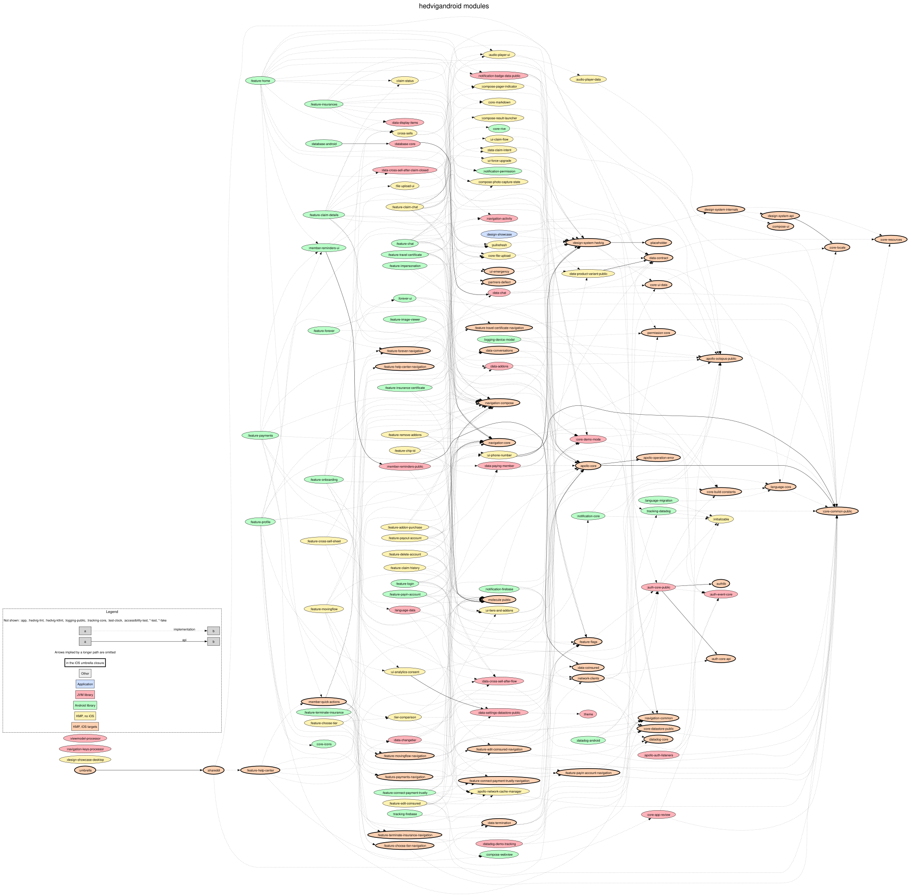

# Hedvig app for Android

## Develop

1. Acquire Lokalise credentials (you can find them in 1Password), place in the following file:
    - `lokalise.properties`
2. Acquire gradle.properties which contain a token for Github Packages authentication. 
   Generate your own at GitHub > Settings > Developer Settings > PAT > Tokens (Classic) > Generate New Token > Give the read:packages permission    
   Append (or create) your global gradle.properties in:
    - `~/.gradle/gradle.properties`
   Look inside [ci-prebuild](scripts/ci-prebuild.sh) for inspiration.
3. Download the schema (required to consume any changes in schema as well):
    `./gradlew downloadOctopusApolloSchemaFromIntrospection`
4. Download lokalise translations (required to consume latest translations as well):
    `./gradlew downloadStrings`
5. Build and install via Android Studio

## Formatting

Formatting is handled with ktlint with extra configuration defined in [`.editorconfig`](.editorconfig)
run `./gradlew ktlintCheck` to check that the files follow the rules
run `./gradlew ktlintFormat` to make ktlint to format all files according to the rules 

## Build Types

* Release: `com.hedvig.app` Build for the customer on Play Store. Using production backend
* Staging: `com.hedvig.app` Build for internal testing using Firebase App Distribution. Using staging backend
* Develop: `com.hedvig.dev.app` Build for development. Using staging backend

## Module structure

Generated from `./gradlew :generateProjectDependencyGraph --no-configuration-cache`, which also writes
[`misc/images/modularization-summary.md`](misc/images/modularization-summary.md) with a count per module
kind and the non-KMP modules that other modules still depend on. Requires graphviz: `brew install graphviz`.
Test modules, `:app`, and the modules the convention plugin attaches to everything are left out. Arrows implied by a longer path are omitted.

Before the 2026 KMP-readiness migration the graph showed 62 KMP modules with iOS targets, 1 without,
46 Android libraries and 22 JVM libraries; after it, 46 KMP modules with iOS targets, 27 without,
35 Android libraries and 22 JVM libraries. The current counts are in the summary file.

## Renovate

`renovate.json` is a file which Renovate looks at in order to be able to suggest upgrading private artifacts to their latest version.

## Removing unused resources

The [android-remove-unused-resources-plugin](https://github.com/irgaly/android-remove-unused-resources-plugin/tree/main#usage)
plugin is used to achieve this. This will run on CI using [this task](./.github/workflows/unused-resources.yml), but to run locally one can also just do
`./gradlew :app:lint -Prur.lint.onlyUnusedResources`
And then
`./gradlew :app:removeUnusedResourcesDebug`

## Sharing code with iOS via HedvigShared

The `:umbrella` module produces the binary the iOS app consumes for shared KMP code — exported module list in `app/umbrella/build.gradle.kts`. Two distribution paths:

- **Production**: `umbrella.yml` runs `:umbrella:assembleHedvigSharedReleaseXCFramework` and publishes the resulting multi-slice XCFramework as a Swift Package (~25 min round-trip).
- **Local dev**: Ugglan's `scripts/use-local-umbrella.sh` flips its Tuist project so a pre-build phase calls `:umbrella:embedAndSignAppleFrameworkForXcode` from a sibling `android/` checkout on every Xcode build (~5–10s per Kotlin change). See the *Iterating on shared KMP code* section in Ugglan's README.

(`:umbrella:embedAndSignAppleFrameworkForXcode` only works from an Xcode build phase — it reads `CONFIGURATION`, `SDK_NAME`, `ARCHS`, `BUILT_PRODUCTS_DIR` from the env.)

`:umbrella` is `isStatic = true`. Compose Resources you add to shared modules land at `<App>.app/compose-resources/composeResources/...` on iOS via `ugglan/scripts/post-build-action.sh` — that script is the source of truth for the iOS bundle layout.